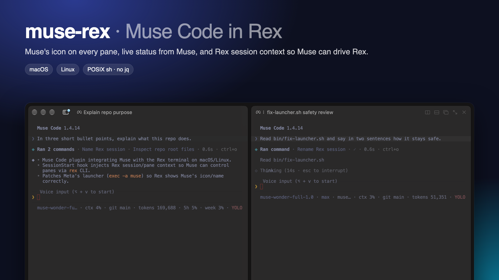

<p align="center"></p>

<h1 align="center">muse-rex</h1>



A [Muse Code](https://meta.ai) plugin that makes Muse feel at home in the
[Rex](https://www.superlogical.com/rex) terminal multiplexer, on macOS and Linux.

- **Icon.** Rex shows Muse's icon and name on its pane and in the session list,
  like it does for Claude Code and Codex.
- **Rex awareness.** At the start of each session Muse is told which Rex
  session and pane it is running in, the same context Rex gives Claude Code and
  Codex. Muse can then use the `rex` command to name its session, split panes,
  run commands beside itself, and read other panes.
- **Status.** Muse already reports working, needs approval, and done to Rex
  through Rex's [Program Status Protocol](https://www.superlogical.com/rex/docs/build/program-status)
  (OSC 7501). This plugin leaves that to Muse, so you see the spinner and
  "blocked" markers without duplicate reports.

## Requirements

| Requirement | Why |
| --- | --- |
| Muse Code 1.4.13 or newer | Plugin marketplaces, hooks, and native status reports |
| Rex, with `rex` on your `PATH` | Session context comes from `rex __internal session-start` |
| `sh`, `awk`, `ps` | The hook is plain POSIX sh. No `jq` or Python needed |

Works with Meta's launcher wherever it lives (`~/.local/bin`, mise, or a
directory such as `/usr/local/lib/muse`), and with packaged installs such as
Arch's `muse-code-bin`. Tested in both sandboxed and YOLO sessions.

## Install

```sh
curl -fsSL https://raw.githubusercontent.com/BlockedPath/muse-rex/main/install.sh | sh
```

That's it. Start Muse in a Rex pane. The script:

1. adds this repo as a Muse plugin marketplace (`muse-rex`) and installs the
   `rex` plugin from it,
2. trusts the plugin's one hook with `muse plugins approve rex` (Muse doesn't
   run third-party hooks until you do),
3. applies the launcher fix, so the icon shows from the next launch.

It's safe to run again, and running it again is also how you update. Read
[`install.sh`](install.sh), [`hooks/session-start.sh`](hooks/session-start.sh),
and [`bin/fix-launcher.sh`](bin/fix-launcher.sh) first if you like; they are
short.

For Rex's full usage guide, Muse should also have a `rex` skill. The installer
tells you if `muse skills list` doesn't show one; `rex skill setup` installs it
into `~/.agents/skills`, where Muse finds it.

### By hand

```sh
muse plugins marketplace add muse-rex BlockedPath/muse-rex
muse plugins install rex@muse-rex
muse plugins approve rex
```

The icon then appears from the second launch, after the hook has fixed the
launcher once.

## Update and remove

```sh
curl -fsSL https://raw.githubusercontent.com/BlockedPath/muse-rex/main/install.sh | sh                  # update
curl -fsSL https://raw.githubusercontent.com/BlockedPath/muse-rex/main/install.sh | sh -s -- --uninstall # remove
```

By hand: `muse plugins marketplace update muse-rex && muse plugins update rex && muse plugins approve rex`
to update (an update changes the hook, so approve it again), and
`muse plugins remove rex && muse plugins marketplace remove muse-rex` to remove.

## How the icon works

Rex picks a pane's icon from the running program's `argv0`, and already knows
`muse`. Packaged installs run `.../lib/muse/muse`, so they get the icon with no
help. Meta's launcher, which mise also uses, starts the real binary as
`.../muse-bin-<version>`, which Rex doesn't recognize. The fix changes one line
in that launcher:

```diff
-  exec "$binary" "$@"
+  exec -a muse "$binary" "$@"
```

The launcher updates itself and undoes the change. The plugin's SessionStart
hook applies it again each session, so a launch after an update is fixed the
next time. The fix only touches files that are Meta's launcher, replaces the
file atomically, and keeps its permissions.

Check or apply it by hand, or point it at a launcher elsewhere:

```sh
sh bin/fix-launcher.sh --check
sh bin/fix-launcher.sh [/path/to/muse]
```

To stop the hook from changing your launcher:

```sh
mkdir -p ~/.config/muse-rex && touch ~/.config/muse-rex/no-launcher-fix
```

## How the session context works

Muse runs hooks with an environment allowlist that drops `REX_SESSION`,
`REX_BLOCK`, and `REX_SERVER`. The hook walks up its process tree to Muse and
reads them from Muse's environment (`/proc/<pid>/environ` on Linux, `ps -E` on
macOS), then asks Rex for the context text with
`rex __internal session-start --agent muse`. Outside Rex it prints nothing.

## Troubleshooting

| Symptom | Check |
| --- | --- |
| No icon | `rex block call -b <pane> process` shows `argv0`. It should be `muse` or end in `/muse`. Run `sh bin/fix-launcher.sh --check`. |
| Muse doesn't know its pane | `muse plugins inspect rex` should show `status=trusted_enabled`. If not, run `muse plugins approve rex`. |
| No status markers | `rex block call -b <pane> program_status` lists what Muse reported. That comes from Muse itself, not this plugin. |

Muse 1.4.13 runs SessionStart hooks when you send the first prompt rather than
at launch, so the context and the launcher fix arrive then.

## License

MIT
